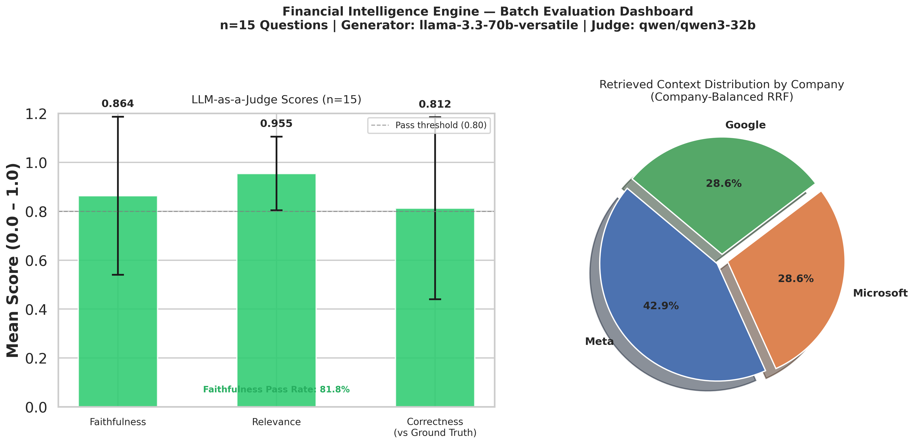
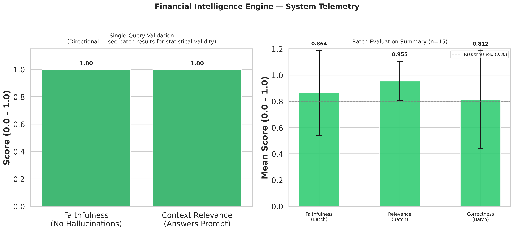

# Financial Intelligence Engine (Enterprise RAG)

<p align="left">
  <a href="https://huggingface.co/spaces/deep123shah456/financial-intelligence-engine" target="_blank">
    
  </a>
  <a href="https://github.com/DeepShah111/financial-intelligence-engine" target="_blank">
    
  </a>
</p>

<p align="left">
  
  
  
  
  
  
  
</p>

> An Agentic RAG system for SEC 10-K financial analysis.  
> It reduces unsupported claims through a Dual-LLM guardrail (generator + compliance auditor), custom Rank Fusion, query-aware retrieval routing, an independent judge model, and a fixed regression test set run against the real pipeline.

---

## 🚀 Live Demo

**Try it now — no setup, no API key required:**

👉 **[https://huggingface.co/spaces/deep123shah456/financial-intelligence-engine](https://huggingface.co/spaces/deep123shah456/financial-intelligence-engine)**

[](https://huggingface.co/spaces/deep123shah456/financial-intelligence-engine)

The live application allows you to:
- Ask any question about the Google, Meta, or Microsoft 10-K filings and get a cited answer that has been reviewed by a second "compliance auditor" model
- See the exact retrieved source chunks with company label and page number
- Enable Query Decomposition to split complex multi-company questions into focused sub-queries
- Toggle real-time Faithfulness + Relevance scoring via an independent Qwen3-family judge model (a different model family from the generator)
- Ask follow-up questions — the conversation memory module automatically contextualises prior turns (each visitor has their own memory)

> **First load note:** On the free Hugging Face tier the Space restarts after inactivity. After a restart, click **Initialize Pipeline** and wait — the search index is rebuilt from the PDFs, which takes about 15 minutes. Once it says *"Pipeline initialized and ready"*, questions are answered in seconds.

> **Data note:** Microsoft's filing covers the fiscal year ended **June 30, 2024**, one year earlier than the Google and Meta filings. Cross-company answers can therefore span different periods. The app footer says this too.

---

## 📸 Demo Screenshots

> The screenshots below were captured on earlier versions of the app. The interface is the same; the retrieval details in the captions (for example chunk counts) have since been improved — see [Section 4](#4-technical-decisions--rationale) and [Section 12](#12-engineering-change-log).

#### Pipeline Initialized — Live on HuggingFace Spaces
<p align="center">
  
</p>

*The full RAG pipeline running live on HuggingFace Spaces free-tier CPU. The architecture summary at the bottom shows the technical stack — Hybrid Dense + BM25 → Custom RRF → Chain-of-Thought generator → Compliance Auditor → independent Judge — visible to any recruiter who scrolls.*

---

#### Cited Answer with Retrieved Sources
<p align="center">
  
</p>

*Every claim in the answer is followed by its source citation (`[Source: Meta 10-K]`). The right panel shows the exact retrieved chunks with company label and page number, so any figure can be checked against the filing. This is the compliance auditor (Stage 2) working: it removes claims that are not supported by the retrieved text (it reduces unsupported claims; it is not a guarantee).*

---

#### Query Decomposition Reasoning Chain
<p align="center">
  
</p>

*For a complex multi-company question, the system decomposes it into focused sub-queries — each retrieved independently. The Reasoning Chain panel shows the merged chunks per company (in this capture: 13 unique chunks across Google 4, Meta 5, Microsoft 4). Deduplication by deterministic chunk ID, synthesis, and compliance audit all happen before the final answer is shown. In the current version, questions that refer to "all three companies" without naming them are kept whole (see 4.7), and requests with three or more sub-queries keep their best 4–5 chunks each.*

---

#### Real-Time Evaluation Scores — Faithfulness 1.000 · Relevance 1.000
<p align="center">
  
</p>

*After every answer, a Qwen3-family judge — a completely different model family from the generator — independently scores the response. Faithfulness 1.000 means every claim is supported by the retrieved context. Relevance 1.000 means the answer fully addresses the question. In the current version the judge scores an honest "this is not in the filings" answer as Faithfulness 1.0 but Relevance 0.3, because it is faithful but does not answer the question (see 4.5). Using a different model family as judge prevents circular self-evaluation bias.*

---

#### Conversation Memory — Follow-Up Questions
<p align="center">
  
</p>

*Turn 1 asks about Google's revenues. Turn 2 asks "How does that compare to Meta's performance?" — without mentioning Google. The ConversationMemory module detects the implicit reference, reformulates the retrieval query with prior context, and returns a cross-company comparative answer citing chunks from both Google and Meta 10-Ks.*

---

## Table of Contents

1. [The Business Problem](#1-the-business-problem)
2. [What Makes This Different](#2-what-makes-this-different)
3. [Pipeline Architecture](#3-pipeline-architecture)
4. [Technical Decisions & Rationale](#4-technical-decisions--rationale)
5. [Evaluation Results](#5-evaluation-results)
6. [Repository Structure](#6-repository-structure)
7. [Quickstart](#7-quickstart)
8. [Dataset](#8-dataset)
9. [Interactive Demo](#9-interactive-demo)
10. [Deployment on Hugging Face Spaces](#10-deployment-on-hugging-face-spaces)
11. [Known Limitations](#11-known-limitations)
12. [Engineering Change Log](#12-engineering-change-log)

---

## 1. The Business Problem

Financial analysis requires absolute precision. Standard Generative AI models hallucinate numbers, lose context in long documents, and fail to synthesize comparative data when parsing dense regulatory filings like SEC 10-Ks.

### Data note
The corpus is three 10-K filings. Microsoft's filing covers the fiscal year ended
June 30, 2024, one year earlier than the Google and Meta filings. Cross-company
comparison answers may therefore span different periods; the answers cite the
company filing they come from.

The three failure modes that make off-the-shelf LLMs unusable for financial work:

| Failure Mode | What Happens | Business Consequence |
|---|---|---|
| Hallucination | Model invents revenue figures not in the filing | Analyst acts on fabricated data |
| Context loss | Long documents exceed attention window | Key financial metrics silently dropped |
| Knowledge bleed | Model uses pre-trained knowledge, not the filing | Answers reflect outdated or wrong fiscal year |

This engine addresses all three with a strictly regulated **Agentic Retrieval-Augmented Generation (RAG)** pipeline. It lets financial analysts cross-examine large, unstructured SEC filings across multiple organizations at once — providing fully cited comparative analysis. The generator is instructed to answer only from the retrieved filing text, a second model audits the draft, and an independent judge scores the result.

**Corpus used for development and evaluation:**
- Google 10-K (FY2025, filed February 2026) — 104 pages
- Meta 10-K (FY2025, filed 2026) — 145 pages
- Microsoft 10-K (FY2024, filed 2024) — 171 pages

---

## 2. What Makes This Different

Most RAG portfolio projects are demos. They retrieve context, pass it to an LLM, and print the output. There is no verification that the output is grounded in the source, no correction mechanism when it isn't, and no repeatable check that the system actually works.

### Side-by-side comparison

| What a standard RAG demo does | What this pipeline does |
|---|---|
| Single retrieval method (dense only) | Hybrid retrieval: Dense vectors + BM25 sparse fused via custom RRF |
| Same search for every question | Query-aware routing: a question about one company is searched inside that company only; a question naming several companies searches each one separately |
| Pasted quotes, abbreviations and odd wording break the search | Query cleanup and expansion (R&D, capex, net income) tuned on the real index |
| Random chunk IDs on every rebuild | Deterministic SHA-256 chunk IDs — index stable across re-runs |
| One LLM call, output printed directly | Two-stage pipeline: CoT generator → SEC compliance auditor |
| No evaluation | LLM-as-a-Judge evaluation, plus a fixed 15-question regression set with pass/fail checks on the figures |
| Self-referential eval (model judges itself) | Separate model family as judge (Qwen3 judges the gpt-oss generator) |
| A "not available" answer scores as perfect | Judge rules: an honest refusal is faithful (1.0) but not relevant (≤0.3) |
| Single question scored | Batch evaluation with mean ± std dev reported |
| No ground truth | Ground truth extracted directly from source 10-K filings |
| Corpus dominated by one source | Company-balanced RRF — no single company exceeds 43% of context |
| Crashes on API limits or empty model replies | Guards: fallback when the auditor returns nothing, one retry when the generator returns nothing, chunk cap that stays under the Groq free-tier token limit |
| No UI | Gradio interactive demo with real-time evaluation scores |
| Single-turn only | Multi-turn conversation memory (last 3 turns as retrieval context, kept per visitor) |
| Single monolithic query | Optional query decomposition for complex multi-part questions |

---

## 3. Pipeline Architecture

```
SEC 10-K PDFs (Google, Meta, Microsoft)
        │
        ▼
┌─────────────────────────────────────┐
│         data_ingestion.py           │
│  ThreadPoolExecutor parallel parse  │
│  RecursiveCharacterTextSplitter     │
│    (1,200 chars, 250 overlap)       │
│  SHA-256 deterministic chunk IDs    │
│  Company + source metadata tagging  │
└──────────────────┬──────────────────┘
                   │  1,617 annotated chunks
                   ▼
┌─────────────────────────────────────┐
│        retrieval_engine.py          │
│                                     │
│  Query cleanup + expansion:         │
│    strip pasted quotes; write out   │
│    R&D / capex; add helper words    │
│    for "net income" and "R&D"       │
│                                     │
│  Dense Index:                       │
│    ChromaDB + Jina embeddings v3    │
│    (API, no local model)            │
│                                     │
│  Sparse Index:                      │
│    BM25 (atomic write + SHA-256     │
│    integrity verification on load)  │
│                                     │
│  Fusion:                            │
│    Custom Weighted RRF              │
│    score += w × (1 / (rank + 60))  │
│                                     │
│  Routing:                           │
│    1 company named  → search that   │
│                       company only  │
│    2+ companies     → search each   │
│    named              separately    │
│    none named       → company-      │
│                       balanced      │
│                       (max 3 each)  │
└──────────────────┬──────────────────┘
                   │  7 documents (8–9 when 2–3 companies are named)
                   ▼
┌─────────────────────────────────────┐
│        generation_agent.py          │
│                                     │
│  [Optional] Query Decomposition:    │
│    gpt-oss-120b splits complex      │
│    query into 2–4 sub-queries       │
│    → per-sub-query retrieval        │
│    → ID-based dedup + merge         │
│    → synthesis prompt               │
│                                     │
│  Stage 1 — CoT Generator:           │
│    gpt-oss-120b (Groq)              │
│    Extract facts → identify gaps    │
│    → structured comparative answer  │
│                                     │
│  Stage 2 — Compliance Auditor:      │
│    gpt-oss-120b (adversarial role)  │
│    Strip any claim not in context   │
│    Enforce citation on every fact   │
│                                     │
│  Retry: tenacity exponential        │
│  backoff (3 attempts, 2–10s)        │
│  Guards: empty-reply fallback/retry │
└──────────────────┬──────────────────┘
                   │  Audited, cited answer
                   ▼
┌─────────────────────────────────────┐
│           evaluation.py             │
│                                     │
│  Judge: Qwen3 family (Groq)         │
│  (different family from generator)  │
│                                     │
│  Metrics:                           │
│    Faithfulness  — grounded in ctx? │
│    Relevance     — answers prompt?  │
│    Correctness   — matches GT?      │
│                                     │
│  Batch: n=15 verified questions     │
│  Output: mean ± std dev + report    │
└──────────────────┬──────────────────┘
                   │
                   ▼
┌─────────────────────────────────────┐
│   gradio_app.py + conversation.py   │
│                                     │
│  Gradio UI:                         │
│    Chat panel with cited answers    │
│    Retrieved sources + page nums    │
│    Real-time eval scores (Qwen3)    │
│    Decomposition reasoning chain    │
│    6 example question buttons       │
│    Data note footer                 │
│                                     │
│  ConversationMemory (per visitor):  │
│    Rolling 3-turn window            │
│    Follow-up query reformulation    │
│    (pronoun / reference detection)  │
└─────────────────────────────────────┘
```

The model names are set in one place, `src/config.py` (`GENERATOR_MODEL`, `EVALUATOR_MODEL`, `EMBEDDING_MODEL_NAME`).

---

## 4. Technical Decisions & Rationale

### 4.1 Hybrid Retrieval — Why Both Dense and Sparse

Financial documents contain two fundamentally different types of information that require different retrieval strategies:

| Query Type | Example | Best Retrieval |
|---|---|---|
| Semantic / conceptual | "What are Meta's AI strategy risks?" | Dense (ChromaDB + embeddings) |
| Exact financial figure | "Google R&D expenses $61.087 billion" | Sparse (BM25 keyword match) |

Using dense retrieval alone misses exact dollar amounts because embeddings compress meaning and lose precise numerical tokens. Using sparse retrieval alone misses contextual questions because BM25 has no semantic understanding. The custom RRF layer fuses both scoring systems into a single ranked list using the formula:

```
score(doc) += weight × (1 / (rank + K))
```

where K=60 is the standard RRF smoothing constant and weights are 0.5/0.5 for equal contribution. This formulation is mathematically correct — the weight scales the entire RRF fraction, not just the numerator.

Each search hands a pool of candidates to the fusion step (20 from the dense search, up to 60 from BM25 before filtering), so a relevant chunk ranked 8th or 15th by one search can still take part in the fusion. The final answer uses the top 7.

### 4.2 Deterministic Chunk IDs — Why SHA-256 Over UUID4

The original system used `uuid.uuid4()` (random) to assign chunk IDs. This caused a silent correctness bug: every time the pipeline ran, the same chunk received a different ID. The RRF deduplication logic uses chunk IDs as dictionary keys — if the same document chunk has two different IDs across two retrieval calls, it appears twice in the fused result instead of having its scores merged.

The fix uses SHA-256 over the content + source filename:

```python
content_hash = hashlib.sha256(
    f"{source_file}::{chunk_index}::{page_content}".encode()
).hexdigest()[:16]
chunk_id = f"{stem}_{content_hash}"   # e.g. "google_10k_a3f9c21b"
```

The same chunk always gets the same ID regardless of when the pipeline runs. Index rebuilds are reproducible and cache-compatible.

### 4.3 Atomic BM25 Serialization — Preventing Split-State Corruption

The original system wrote the BM25 pickle directly to disk. If the process was interrupted mid-write, the file was corrupted but the Chroma directory was intact. On the next run, the smart load logic detected `chroma_exists=True` and `bm25_exists=False`, then fell into the cold build branch which requires `document_chunks` — but the user called `build_indexes()` with no arguments. Unrecoverable `ValueError`.

The fix uses atomic rename:

```python
# Write to temp file first (same filesystem = atomic rename)
with tempfile.NamedTemporaryFile(dir=dir_path, suffix='.pkl') as tmp:
    pickle.dump(sparse_retriever, tmp)
    tmp_path = tmp.name

file_hash = compute_sha256(tmp_path)
shutil.move(tmp_path, self.bm25_path)   # atomic on POSIX

with open(self.bm25_hash_path, 'w') as f:
    f.write(file_hash)                  # SHA-256 sidecar for integrity check
```

On load, the SHA-256 digest is verified before deserialization. A mismatch raises `RuntimeError` with a clear recovery instruction rather than silently loading a corrupt index. An index is also counted as complete only when all three files exist (`chroma.sqlite3`, `bm25_index.pkl`, `bm25_index.sha256`); otherwise the partial index is cleared and rebuilt.

### 4.4 Company-Balanced Retrieval — Fixing Corpus Bias

Before this fix, the retriever returned 71.4% Meta chunks for any multi-company query. This happened because Meta's 10-K (145 pages) was larger than Google's (104 pages), giving Meta more total chunks in both the dense and sparse indexes. A query asking to compare Google and Meta would retrieve 5 Meta chunks and 1 Google chunk — the answer was structurally biased before the LLM ever ran.

The fix applies a per-company cap after RRF fusion:

```python
# config.py: cap = ceil(TOP_K / number of companies) = ceil(7 / 3) = 3
MAX_CHUNKS_PER_COMPANY = math.ceil(TOP_K_VECTORS / NUM_COMPANIES)

for chunk_id, score in sorted_docs:
    company = doc_map[chunk_id].metadata.get('company')
    if company_counts.get(company, 0) < MAX_CHUNKS_PER_COMPANY:
        company_counts[company] += 1
        balanced.append(doc_map[chunk_id])
```

The cap is rounded **up**: `7 // 3 = 2` would cap three companies at 2 chunks each and could never fill all 7 slots.

Result (measured when the fix was introduced): retrieval distribution changed from **71% / 14% / 14%** to **43% / 29% / 29%**. Every cross-company query now receives meaningful context from all three filings. This balanced path is still used for questions that name no company (for example "Compare the capital expenditures of all three companies."); questions that name companies are routed as described in 4.10.

### 4.5 Separate Judge Model — Preventing Circular Evaluation

Using the same model to generate and evaluate its own answers inflates scores due to self-consistency bias — the model does not recognize its own failure modes. The evaluation module uses a **Qwen3-family model** (Alibaba Qwen architecture, set as `EVALUATOR_MODEL` in `src/config.py`) as the judge for outputs generated by `openai/gpt-oss-120b` (OpenAI open-weight architecture). These are completely different model families with different training data, tokenizers, and failure modes. (An earlier version of the project used `llama-3.3-70b-versatile` as generator and `qwen/qwen3-32b` as judge; see 5.4.)

**Judge scoring rules** (added after live testing showed the judge making two mistakes):

- *Units.* Financial tables are in millions. A figure that is the same number in other units or rounded (for example `$44,477 million` written as `$44.5 billion`) counts as supported. Before this rule, correct converted figures could be scored 0.0 for faithfulness.
- *Honest refusals.* A statement that something is "not disclosed in the provided excerpts" is not an unsupported claim (faithfulness stays 1.0). But if the answer gives **none** of the requested facts and only says they are unavailable, **relevance is capped at 0.3** — an honest refusal is faithful, but it does not answer the question. If the answer gives the main requested figure and only notes a secondary gap, relevance is scored by the share of the question answered.
- *Faithfulness is the share of supported claims*, and 0.0 is reserved for answers that are mostly invented.

Result on the live app: "What was Apple's revenue in 2025?" now scores Faithfulness 1.000 / Relevance 0.300 (before: 1.0 / 1.0), while correct answers such as Google R&D stay at 1.0 / 1.0. The score panel colours are green ≥ 0.85, yellow ≥ 0.70, red < 0.70.

### 4.6 Ground Truth From Source Documents — Not Approximations

Every `ground_truth` value in the evaluation set was extracted directly from the uploaded 10-K PDFs using programmatic text extraction. No approximations, no rounded figures.

Examples:
- Google R&D FY2025: **$61.087 billion** (extracted from income statement table)
- Meta total revenue FY2025: **$200.966 billion** (extracted from consolidated statements)
- Microsoft cloud revenue FY2024: **$137.4 billion** (extracted from segment reporting)

This matters because a `ground_truth` string of "$49 billion" when the filing says "$49.326 billion" will score 0.0 on correctness even if the answer is factually right. Approximate ground truth produces a meaningless correctness metric.

### 4.7 Query Decomposition — Handling Multi-Part Questions

Standard single-shot retrieval fails on complex comparative questions like *"Compare Google and Meta's R&D spending and headcount trends."* A single query vector averages the semantics of both companies and both metrics, causing the retriever to favour whichever sub-topic has the strongest embedding signal — typically one company and one metric.

The decomposer (the generator model with a strict JSON-only prompt) splits the question into 2–4 focused sub-queries:

```
"Compare Google and Meta's R&D spending and headcount trends"
  → ["What were Google's total R&D expenses and YoY change?",
     "What were Meta's total R&D expenses and YoY change?",
     "What were Google's headcount figures?",
     "What were Meta's headcount figures?"]
```

Each sub-query is retrieved independently. Chunks are merged and deduplicated by chunk ID (the same deterministic SHA-256-based key used throughout the pipeline) before being fed to a synthesis prompt. The synthesised draft is then audited by the existing compliance auditor — so the audit applies to decomposed answers too.

Simple / single-focus questions return a 1-element array from the decomposer, making `generate_answer_decomposed` a superset of `generate_answer` with no redundant API calls on simple queries.

**Safeguards added after live testing:**

- *The decomposer knows the corpus.* Its prompt states that the filings cover exactly three companies — Google (Alphabet), Meta and Microsoft — and that it must never add another company or invent a fiscal year. (Before this rule, "compare the capital expenditures of all three companies" was once split into sub-queries about Apple and Amazon for FY2023.)
- *"All three companies" is not split.* A question that says "all three companies" or "each company" without naming them is returned whole as a single sub-query. A single sub-query is then searched with the user's **original wording**, not the decomposer's rewording — rewording had hidden Microsoft's capex line.
- *Token-limit cap.* Groq's free tier rejects requests above about 8,000 tokens per minute (HTTP 413). Three sub-queries of 7 chunks each (21 chunks) went over that limit. With three or more sub-queries, each now keeps its best 5 (3 sub-queries) or 4 (4 sub-queries) chunks, at most about 16 in total. One or two sub-queries are unchanged.

### 4.8 Conversation Memory — Contextualising Follow-Up Questions

A rolling-window `ConversationMemory` (default: 3 turns) detects follow-up questions via a signal word scan (`"their"`, `"its"`, `"what about"`, `"also"`, etc., matched as whole words) and appends prior questions as inline context before the query reaches the retriever:

```
Turn 1: "What were Google's R&D expenses?"
Turn 2: "What about their capital expenditure?"
         → reformulated: "What about their capital expenditure?
                          [Prior context: Q1: What were Google's R&D expenses?]"
```

Only the prior *questions* (not full answers) are appended, keeping the retrieval query concise and avoiding the BM25 token limit. The original user question is preserved in history for readable conversation logs.

The memory is stored **per visitor session** (Gradio `gr.State`), not in a shared global, so two people using the live app at the same time cannot see each other's history. Follow-ups are most reliable when the earlier turns are about one company; if the history mentions several companies, "their" is genuinely ambiguous and the answer may cover all of them.

### 4.9 Query Cleanup and Expansion — Found by Testing on the Real Index

The filings print "Research and development" in full and label cash-flow lines differently from how people ask about them, so the question text is cleaned and expanded before searching. Each rule below was found by testing on the real index (checking where the chunk that holds the answer ranks), one failing question at a time:

| Rule | What it does | Measured effect (rank of the chunk holding the answer; 7 or better reaches the generator) |
|---|---|---|
| Quote cleanup | Removes curly and straight double quotes and curly apostrophes | Microsoft net income question pasted inside quotes: rank **20 → 2** |
| "R&D" written out | `R&D` → `research and development` (BM25 cannot match the short form) | — |
| R&D helper words | Appends `expenses as a percentage of revenues table` when R&D is mentioned | "Google R&D FY2025": rank **18 → 1**; "Meta R&D FY2025": improved |
| Capex written out | `capex` / `capital expenditures` → `capital expenditures purchases of property and equipment` | Capex of all three companies reaches the generator for all three |
| Net income helper words | Appends `net income income statements earnings per share diluted` when net income is mentioned | "Microsoft net income … in fiscal 2024?": rank **16 → 1** |

Two things were tried and **rejected** because the measurements showed they were worse: rewriting the question words in place for net income (rank 29), and stripping group words and filler from per-company searches (Microsoft capex rank 4 → 19).

### 4.10 Query-Aware Routing — One Company, Several Companies, or None

The retriever looks at which companies the question names (Google/Alphabet, Meta/Facebook, Microsoft):

| Question names | What the retriever does | Why |
|---|---|---|
| One company | Searches inside that company only; all 7 chunks come from it | Other companies' chunks cannot crowd out the answer |
| Two or more companies | Searches **each company separately** and gives each its own share of the slots (`ceil(7 / n)`: 4 each for two, 3 each for three) | Fixed the "Compare Meta and Microsoft's net income" gap: Microsoft's income statement was never retrieved when the two companies competed in one ranking |
| No company (e.g. "all three companies") | Original company-balanced search (max 3 per company) | Tested: searching each company separately was *worse* for the three-company capex question, because Meta's and Microsoft's capex lines rank 3rd–7th inside their own company |

### 4.11 Reliability Guards

| Failure seen | Guard |
|---|---|
| The auditor returns an empty message (a reasoning model decided "nothing to change" and wrote no text) | The auditor prompt forbids an empty reply, and if one still comes back the generator's `<final_answer>` is used instead (a warning is logged) |
| The generator returns an empty message (`finish_reason=stop`, tokens produced but no visible text; at temperature 0 the same request tends to repeat the same empty reply) | The error message now states why (finish reason, token counts), and the generator retries once at temperature 0.3 before giving up. This retry is tested with stand-ins; it has not been observed firing on the live app |
| Requests over Groq's free-tier token limit (HTTP 413) | Chunk cap per sub-query (see 4.7) |
| Rate limits, timeouts, transient network errors | `tenacity` exponential-backoff retries on every LLM call (3 attempts, 2–10 s) |
| Corrupt or partial index | Atomic BM25 write + SHA-256 check on load; an index counts as complete only when all three files exist (see 4.3) |

---

## 5. Evaluation Results

The project is evaluated in three ways: a fixed regression set run against the real pipeline (current system), spot checks on the live app, and an earlier batch LLM-as-a-Judge run (kept for reference, with caveats).

### 5.1 Fixed regression set — current system (15 questions)

Each question is run through the real pipeline (retrieval → generator → auditor → judge). A check passes when the answer contains the figure(s) it must contain (matched as text) and does not contain claims it must not make (for example Apple or Amazon in a three-company answer, or "both companies reported higher net income than the prior year" when Meta's fell). The test is currently run from a local script; adding it to the repository is on the to-do list.

**Result: 13 of 15 checks pass. All 12 original questions pass.**

| ID | Question | Mode | Result | Judge scores |
|---|---|---|---|---|
| R1 | What were Google's total R&D expenses in FY2025? | single | ✅ | — |
| R2 | Google R&D FY2025 | single (short wording) | ✅ | — |
| R3 | What was Meta's total revenue in 2025? | single | ✅ | — |
| R4 | What was Microsoft's net income for its most recent fiscal year? | single | ✅ | — |
| R5 | Compare Meta and Microsoft's net income for their most recent fiscal year. | two companies | ✅ | — |
| R6 | Same, with decomposition | two companies | ✅ | — |
| R7 | Compare the capital expenditures of all three companies. | decomposition on | ✅ | — |
| R8 | Same, without decomposition | balanced | ✅ | varied 0.4–0.8 |
| R9 | Compare the R&D spending of Google and Meta. | decomposition on | ✅ | — |
| R10 | What was Apple's revenue in 2025? | not in filings | ✅ honest refusal | 1.0 / 0.3 (live) |
| R11 | What will Google's R&D spending be in 2027? | not in filings | ✅ honest refusal | — |
| R12 | What was Microsoft's net income in 2025? | not in filings | ✅ honest refusal | — |
| R13 | What were the capital expenditures for each of the three companies? | decomposition on | ❌ | — |
| R14 | Compare the revenue of all three companies. | decomposition on | ❌ | — |
| R15 | Compare the R&D spending of Google, Meta and Microsoft. | three named, decomposition on | ✅ | — |

**Before and after the fixes** (same 12 original questions): the baseline run had failures including a crash on an empty generator reply (Microsoft net income) and a three-company capex answer that invented Apple and Amazon; all 12 pass now. R13–R15 were added later as extra checks.

How to read this honestly:
- Scores come from single runs. The model runs at temperature 0, but outputs still vary a little between runs; for example the faithfulness score of R8 varied between 0.4 and 0.8 across runs of the same question.
- The two failing checks (R13, R14) are questions that refer to all three companies without naming them; they are listed under [Known Limitations](#11-known-limitations).
- Where a question cannot be answered from the filings (R10–R12), an honest refusal is the passing behaviour; the judge gives such answers a low relevance score by design (Apple: 1.0 / 0.3 on the live app).
- Per-question judge scores were not saved in this document; "—" means not recorded here.

### 5.2 Live-app spot checks

Checked by hand on the live Hugging Face Space:

| Question | Result |
|---|---|
| What were Google's total R&D expenses in FY2025? | $61,087 million; Google p.36 shown in Sources |
| Google R&D FY2025 | $61,087 million, 15% of revenue, +$11.8 billion year on year |
| What was Meta's total revenue in 2025? | $200,966 million |
| What was Meta's research and development expense in 2025? | $57,372 million (+31% on 2024) |
| What was Microsoft's net income for its most recent fiscal year? | $88,136 million (fiscal 2024) |
| Compare Meta and Microsoft's net income… (decomposition off and on) | Meta $60,458 million, Microsoft $88,136 million, gap about $27.7 billion |
| Compare the capital expenditures of all three companies. | Google $52.5B (2024) → $91.4B (2025); Meta $69.69B; Microsoft 44,477 / 28,107 / 23,886 (millions, fiscal 2024/23/22) |
| What about their revenue? (after a Google question) | Google $402,836 million |
| What was Apple's revenue in 2025? | Says the filings do not contain Apple; Faithfulness 1.0, Relevance 0.3 |

### 5.3 Earlier batch LLM-as-a-Judge evaluation (kept for reference)

> **Read this first.** These numbers come from an earlier configuration (generator `llama-3.3-70b-versatile`, judge `qwen/qwen3-32b`). They have **not** been re-measured for the current generator (`openai/gpt-oss-120b`), and the judge prompt has since changed (see 4.5). The faithfulness mean is computed over the 11 questions that returned a usable score, and correctness over 8; the other judge calls errored. Treat them as historical, not as a measurement of the current system. The current system is described by 5.1 and 5.2.

#### 5.3.1 Evaluation Configuration (earlier run)

| Parameter | Value |
|---|---|
| Evaluation set size | 15 questions |
| Generator model (earlier run) | `llama-3.3-70b-versatile` (Meta Llama 3.3) |
| Judge model (earlier run) | `qwen/qwen3-32b` (Alibaba Qwen3 — different family) |
| Ground truth source | Programmatically extracted from source 10-K PDFs |
| Questions with ground truth | 12 of 15 (3 qualitative questions score faithfulness/relevance only) |
| Structured output parsing | LangChain `PydanticOutputParser` — no fragile string manipulation |

#### 5.3.2 Batch Evaluation Results (earlier run, n=15)

| Metric | Mean | Std Dev | Pass Rate | Threshold |
|:---|:---:|:---:|:---:|:---:|
| **Faithfulness** (no hallucinations) | **0.864** | ±0.323 | **81.8%** | ≥ 0.80 |
| **Relevance** (answers the prompt) | **0.955** | ±0.151 | — | ≥ 0.80 |
| **Correctness** (vs verified ground truth) | **0.812** | ±0.372 | — | ≥ 0.60 |

All three metrics exceeded their respective thresholds in that run.

**Faithfulness** measures whether every claim in the generated answer is directly supported by the retrieved context — no outside knowledge, no invented figures. The compliance auditor (Stage 2 of generation) is the main mechanism intended to drive this score.

**Relevance** measures whether the answer directly and completely addresses the question asked.

**Correctness** measures factual agreement between the generated answer and the verified ground truth extracted from source filings — the most demanding metric, because it compares against real figures rather than only judging the answer's own quality.

#### 5.3.3 Evaluation Dashboards

**Primary Dashboard — Batch Evaluation Results**

*All three metrics exceed the 0.80 pass threshold. The pie chart shows the company-balanced retrieval distribution after the corpus bias fix — Meta 42.9%, Google 28.6%, Microsoft 28.6%.*



---

**System Telemetry — Single Query + Batch Summary**

*Left: Single-query validation scores (1.00 / 1.00 — directional reference only). Right: Batch evaluation summary with error bars showing score distribution across the questions.*



---

### 5.4 What the Standard Deviation Tells You

The ±0.323 std dev on faithfulness in the earlier run is explained by question type, not system instability:

- **Factual quantitative questions** (e.g., "What were Google's R&D expenses?"): faithfulness = 1.0 consistently. The compliance auditor effectively removes unsupported claims when the retrieved context contains the exact figure.
- **Qualitative open-ended questions** (e.g., "What regulatory risks does Meta face?"): faithfulness scores vary because the answer requires synthesizing multiple partial-context passages, and the judge model scores synthesis more conservatively than direct retrieval.

This is expected behavior. The high-variance questions are harder — not broken. (With only 11 usable scores, the standard deviation itself is a rough estimate.)

---

## 6. Repository Structure

```text
financial-intelligence-engine/
│
├── artifacts/                       # Auto-generated outputs
│   ├── eval_reports/
│   │   └── batch_eval_report.json   # Full per-question scores + aggregate stats
│   ├── vector_db/                   # ChromaDB persist dir + BM25 pickle + SHA-256
│   │   ├── chroma.sqlite3
│   │   ├── bm25_index.pkl
│   │   └── bm25_index.sha256        # Integrity sidecar
│   └── visualizations/
│       ├── batch_eval_primary.png
│       └── telemetry_dashboard.png
│
├── assets/                          # README image assets
│   ├── batch_eval_primary.png
│   ├── telemetry_dashboard.png
│   └── demos/                       # Live demo screenshots
│       ├── demo_01_pipeline_ready.png
│       ├── demo_02_cited_answer_sources.png
│       ├── demo_03_reasoning_chain.png
│       ├── demo_04_evaluation_scores.png
│       └── demo_05_conversation_memory.png
│
├── data/
│   └── raw_pdfs/                    # The three SEC 10-K filings used to build the index
│       ├── google_10k.pdf
│       ├── meta_10k.pdf
│       └── microsoft_10k.pdf
│
├── notebooks/
│   └── main_execution.ipynb         # Full pipeline — 6 cells, run sequentially
│
├── src/                             # Modular Python package
│   ├── __init__.py
│   ├── config.py                    # Hyperparameters, paths, model names, logging
│   ├── data_ingestion.py            # Parallel PDF parse, SHA-256 chunk IDs
│   ├── jina_embeddings.py           # Jina API embeddings (no local model)
│   ├── retrieval_engine.py          # Hybrid RRF engine, query cleanup/expansion,
│   │                                #   routing, atomic writes, integrity
│   ├── generation_agent.py          # CoT generator + compliance auditor + retry
│   │                                #   + query decomposition (generate_answer_decomposed)
│   ├── conversation.py              # Rolling-window ConversationMemory, follow-up reformulation
│   └── evaluation.py                # Judge prompt + rules, batch eval harness, Pydantic parsing
│
├── app.py                           # Hugging Face Spaces entry point (app_file in the settings block)
├── gradio_app.py                    # Interactive Gradio demo
│
├── .env                             # GROQ_API_KEY and JINA_API_KEY (never commit)
├── .gitignore
├── README.md
├── requirements.txt                 # Pinned dependencies (RAG core + Gradio)
└── .github/workflows/main.yml       # GitHub Actions auto-sync to HuggingFace
```

---

## 7. Quickstart

### Prerequisites

- Google account with Google Drive (for the Colab option)
- Groq API key (free at [console.groq.com](https://console.groq.com)) — used for the generator, auditor and judge
- Jina API key (free at [jina.ai](https://jina.ai)) — used for embeddings
- SEC 10-K PDFs placed in `data/raw_pdfs/`

### Option A — Google Colab (Recommended for the notebook)

**1. Upload the project to Google Drive:**
```
MyDrive/
└── financial-intelligence-engine/
    ├── src/
    ├── notebooks/
    ├── data/raw_pdfs/
    ├── .env
    └── requirements.txt
```

**2. Add your API keys to `.env`:**
```
GROQ_API_KEY=your_groq_api_key_here
JINA_API_KEY=your_jina_api_key_here
```

**3. Open `notebooks/main_execution.ipynb` in Google Colab.**

**4. Install dependencies (first session only):**
```python
!pip install -q -r /content/drive/MyDrive/financial-intelligence-engine/requirements.txt
```

**5. Run cells 1 through 6 sequentially.**

> **Smart Load:** After the first run, the system detects existing indexes on Drive and bypasses all PDF re-processing. Subsequent cold starts take under 3 seconds instead of several minutes.

### Option B — Local (VS Code)

```bash
# Clone
git clone https://github.com/DeepShah111/financial-intelligence-engine.git
cd financial-intelligence-engine

# Virtual environment
python -m venv venv
source venv/bin/activate        # Windows PowerShell: venv\Scripts\activate

# Install pinned dependencies
pip install -r requirements.txt

# Add credentials (put both keys in a .env file; never commit it)
echo "GROQ_API_KEY=your_key_here" > .env
echo "JINA_API_KEY=your_key_here" >> .env

# Run notebook
jupyter notebook notebooks/main_execution.ipynb
```

### Option C — Gradio Demo (Local)

```bash
# Install all deps
pip install -r requirements.txt

# Add credentials (.env with GROQ_API_KEY and JINA_API_KEY)

# Launch
python gradio_app.py
# → open http://localhost:7860
# → click "Initialize Pipeline" (the first run builds the index from the PDFs)
```

### Notebook Cell Reference

| Cell | Phase | Description | Token Cost |
|:---:|---|---|---|
| 1 | Setup | Mount Drive, flush module cache, import | Zero |
| 2 | Retrieval | Smart load indexes or cold build from PDFs | Zero (warm) / High (cold) |
| 3 | Generation | CoT + compliance audit on primary query | ~4,000 tokens |
| 4 | Eval (single) | Quick single-query faithfulness check | ~500 tokens |
| 5 | Eval (batch) | Full 15-question batch evaluation | ~50,000 tokens |
| 6 | Visualization | Generate and save dashboards to Drive | Zero |

> **Token budget note:** The full pipeline (Cells 3–5) consumes approximately 55,000–60,000 tokens. Groq free tier provides 100,000 tokens/day. Run Cell 3 only when needed — the batch evaluation in Cell 5 is the statistically meaningful result. The free tier also limits **tokens per minute** (about 8,000 for the generator model); a request above that returns HTTP 413, which is why decomposed questions cap the chunks they send (see 4.7).

---

## 8. Dataset

**SEC 10-K Annual Filings**

| Filing | Company | Fiscal Year | Period End | Pages | Chunks |
|---|---|---|:---:|:---:|:---:|
| `google_10k.pdf` | Alphabet Inc. (Google) | FY2025 | Dec 31, 2025 | 104 | 394 |
| `meta_10k.pdf` | Meta Platforms Inc. | FY2025 | Dec 31, 2025 | 145 | 608 |
| `microsoft_10k.pdf` | Microsoft Corporation | FY2024 | Jun 30, 2024 | 171 | 615 |
| | | **Total** | | **420** | **1,617** |

> Microsoft's filing is one fiscal year older than the other two. This is a property of the source documents, disclosed in the app footer and in the Data note above.

**Chunking configuration:**
- Chunk size: 1,200 characters
- Chunk overlap: 250 characters
- Separators: `["\n\n", "\n", ".", " ", ""]` — paragraph-first splitting
- Page numbers shown in the app are 1-based, so they match a PDF viewer

**Key verified financial figures used as ground truth:**

| Company | Metric | Value |
|---|---|---|
| Google | R&D Expenses FY2025 | $61.087 billion |
| Google | Total Revenue FY2025 | $402.836 billion |
| Google | Net Income FY2025 | $132.170 billion |
| Google | Capital Expenditures FY2025 | $91.4 billion |
| Google | Cloud Revenue FY2025 | $58.705 billion |
| Meta | Total Revenue FY2025 | $200.966 billion |
| Meta | R&D Expenses FY2025 | $57.372 billion |
| Meta | Net Income FY2025 | $60.458 billion |
| Meta | Reality Labs Operating Loss FY2025 | $19.19 billion |
| Meta | Employees (Dec 31, 2025) | 78,865 |
| Microsoft | Total Revenue FY2024 | $245.122 billion |
| Microsoft | Cloud Revenue FY2024 | $137.4 billion |
| Microsoft | R&D Expenses FY2024 | $29.510 billion |
| Microsoft | Net Income FY2024 | $88.136 billion |

All figures extracted programmatically from source PDFs using `pypdf`. Values verified against the income statement tables in each filing.

---

## 9. Interactive Demo

### 🔗 Live Application

[](https://huggingface.co/spaces/deep123shah456/financial-intelligence-engine)

**Direct link:** `https://huggingface.co/spaces/deep123shah456/financial-intelligence-engine`

No API key needed. No setup. Click **Initialize Pipeline**, then ask. (Screenshots of the five main views are in the gallery at the top of this README.)

> *Warm start:* when the index is already on disk, the pipeline loads in seconds. On the free Hugging Face tier the index is **not** kept across restarts, so the first start after a restart rebuilds it (about 15 minutes); see Section 10.

---

### Demo Features

| Feature | Description |
|---|---|
| **Multi-turn Chat** | Rolling 3-turn conversation memory, kept per visitor. Follow-up questions are automatically contextualised. |
| **Retrieved Sources** | Every answer shows exact chunks with company label and page number. |
| **Real-time Scores** | An independent Qwen3-family judge scores Faithfulness + Relevance after each answer (green ≥ 0.85, yellow ≥ 0.70, red < 0.70). |
| **Query Decomposition** | Complex questions split into focused sub-queries, retrieved independently, then synthesised. |
| **Reasoning Chain** | Full transparency into sub-queries, chunk counts, and company balance. |
| **6 Example Questions** | One-click buttons covering factual, comparative, and qualitative query types (listed below). |
| **Data note footer** | States that Microsoft's filing covers the fiscal year ended June 30, 2024. |
| **Clear Conversation** | Resets the chat, sources, scores, reasoning chain and memory. |

**The six example questions:**
1. What were Google's total R&D expenses in FY2025?
2. Compare Meta and Microsoft's net income for their most recent fiscal year.
3. What AI infrastructure investments did Google announce in their 10-K?
4. How did Meta's Reality Labs perform — what was its operating loss?
5. Compare the capital expenditures of all three companies.
6. What regulatory and AI-related risks did Microsoft highlight in their filing?

### Conversation Example

```
┌──────────────────────────────────────────────────────────────────────────┐
│  Turn 1                                                                  │
│  User:  What were Google's total R&D expenses in FY2025?                 │
│                                                                          │
│  Agent: Google reported total R&D expenses of $61.087 billion for       │
│         FY2025 [Source: Google 10-K].                                   │
│                                                                          │
│  Scores: Faithfulness 🟢 1.000  ·  Relevance 🟢 1.000                  │
├──────────────────────────────────────────────────────────────────────────┤
│  Turn 2  (follow-up detected → query reformulated with Turn 1 context)  │
│  User:  How does that compare to Meta's performance in the same year?   │
│                                                                          │
│  Agent: [Full cross-company comparative analysis — Google vs Meta       │
│          R&D, revenue, and operating income with per-source citations]  │
│                                                                          │
│  Scores: Faithfulness 🟢 1.000  ·  Relevance 🟢 1.000                  │
├──────────────────────────────────────────────────────────────────────────┤
│  Turn 3  (query decomposition enabled)                                  │
│  User:  Compare all three companies' R&D, net income and capex          │
│                                                                          │
│  🔍 Decomposed into 3 sub-queries — retrieved independently:            │
│     1. Google's R&D, net income, and capital expenditures FY2025        │
│     2. Meta's R&D, net income, and capital expenditures FY2025          │
│     3. Microsoft's R&D, net income, and capital expenditures FY2025     │
│                                                                          │
│  Merged retrieval: 13 unique chunks (ID-based deduplicated)             │
│  By company: Google 4 · Meta 5 · Microsoft 4                           │
└──────────────────────────────────────────────────────────────────────────┘
```

*The Turn 3 box is illustrative of an earlier version. The sub-queries the decomposer writes vary by question and by version; in the current version, three or more sub-queries keep their best 4–5 chunks each (see 4.7).*

---

## 10. Deployment on Hugging Face Spaces

The live demo runs on a free Hugging Face Space (Gradio SDK). What it needs:

| Item | Detail |
|---|---|
| **Settings block** | The YAML block at the very top of this README (starting on line 1, column 0) configures the Space: `sdk: gradio`, `sdk_version: 4.44.1`, `python_version: '3.11'`, `app_file: app.py`. The Gradio version must match the version in `requirements.txt` — a mismatch makes the build fail with "Cannot install gradio==… and gradio==…". |
| **Secrets** | Add `GROQ_API_KEY` and `JINA_API_KEY` under *Settings → Variables and secrets*. Without `JINA_API_KEY` the pipeline fails to initialise with `401 Unauthorized` from `api.jina.ai`. |
| **Index** | The sync workflow does not upload `artifacts/`, so after every restart **Initialize Pipeline** rebuilds the index from the PDFs (about 15 minutes on free CPU). |
| **Sync** | `.github/workflows/main.yml` pushes the repository to the Space. A green GitHub Actions run does **not** prove the Space updated — open the Space's *Files* tab and check the latest commit message. |
| **Hosting plan** | Free CPU Spaces sleep after inactivity. Creating a new Gradio Space on free hardware may now require a Hugging Face PRO account; an existing Space keeps running. |

---

## 11. Known Limitations

Stated plainly, so the project is not read as more than it is:

- **Microsoft's filing is one fiscal year older** (year ended June 30, 2024) than the Google and Meta filings (calendar 2025). Cross-company comparisons can span different periods. This is disclosed in the app and here.
- **Three-company questions that name no company can still miss figures.** Two wordings fail the regression set: "What were the capital expenditures for each of the three companies?" (R13) and "Compare the revenue of all three companies." (R14).
- **Microsoft's capex line is hard to retrieve.** Asked directly with long wording ("What were Microsoft's capital expenditures in the most recent fiscal year?") the chunk ranked 29th in testing; short wording works. Microsoft's capex answer also comes without year labels (the filing's column order gives fiscal 2024, 2023, 2022).
- **Answers vary a little from run to run**, even at temperature 0, and so do judge scores. For example the faithfulness score on the non-decomposed three-company capex answer varied between 0.4 and 0.8 across runs.
- **The auditor reduces unsupported claims; it does not guarantee zero.** The judge is a second model, not ground truth.
- **The judge's relevance rule is deliberately strict.** An honest "the filings do not say" answer is scored relevance ≤ 0.3, even though it is the correct behaviour.
- **The earlier batch scores (0.864 / 0.955 / 0.812) are from a previous model setup** and have not been re-measured; only 11 (faithfulness) and 8 (correctness) scores were usable.
- **The regression set is small** (15 questions, single runs, checks are string matches) and is not yet part of the repository. There are no automated unit tests, and no ablation table comparing dense-only, BM25-only and hybrid retrieval.
- **The empty-generator-reply retry** is tested with stand-ins only.
- **Hosting:** the free Space rebuilds its index after every restart (about 15 minutes), the Groq free tier limits tokens per minute (HTTP 413 above about 8,000), and `chromadb` is not version-pinned. `artifacts/vector_db/chroma.sqlite3` is tracked in Git and changes whenever the index is opened — run `git restore artifacts/vector_db/chroma.sqlite3` before committing, and commit specific files rather than using `git add -A`.
- **Scope:** three filings, one year each. It is a demonstration of the engineering, not a financial-advice tool.

---

## 12. Engineering Change Log

Problems found by testing the live system, and what was done about each:

| # | Problem found | Fix | How it was checked |
|---|---|---|---|
| 1 | The auditor sometimes returned an empty message, so no answer appeared | Auditor prompt forbids empty replies; fallback to the generator's `<final_answer>` | Live app answers; stand-in tests |
| 2 | Follow-up memory was one global object shared by all visitors | Per-session memory (`gr.State`) | Two-window test |
| 3 | Source page numbers started at 0 and did not match a PDF viewer | Display page + 1 | Compared with the PDF |
| 4 | A half-built index (missing files) was treated as complete | Index counted complete only with `chroma.sqlite3` + `bm25_index.pkl` + `bm25_index.sha256` | Cold-start rebuild on the Space |
| 5 | "R&D" and "capex" questions missed the answer chunk (filings write "Research and development" in full) | Written out before searching | Chunk rank on the real index |
| 6 | Single-company questions were crowded out by other companies' chunks | Search inside that company only | Live Google R&D answer |
| 7 | Judge scored correct converted figures ($44,477 million as $44.5 billion) as 0.0 | Scoring rules for units and rounding | Judge re-run on the same answer |
| 8 | Space build failed ("Cannot install gradio==4.44.1 and gradio==5.15.0") | Settings block pinned to `sdk_version: 4.44.1`, starting at column 0 | Space builds and runs |
| 9 | Space initialisation failed with `401 Unauthorized` from Jina | Added the `JINA_API_KEY` secret | Space initialises |
| 10 | Generator returned an empty reply with no explanation | Error now states the reason; one retry at temperature 0.3 | Stand-in tests; the empty reply was seen in the baseline regression run |
| 11 | Microsoft net income was not found ("not disclosed") | Helper words appended for "net income"; in-place rewriting was tried and rejected (rank 29) | Rank 2 → 1 on the real index; live answer $88,136M |
| 12 | Pasted quotes (“…”) pushed the answer chunk from rank 2 to rank 20 | Quote cleanup before searching | Same question: rank 2 |
| 13 | "Google R&D FY2025" (short wording) missed the R&D table | R&D helper words appended | Rank 18 → 1; live answer $61,087M |
| 14 | Comparing two named companies missed Microsoft's net income | Each named company searched separately with its own slots | Meta $60,458M and Microsoft $88,136M with decomposition off |
| 15 | Judge scored "not available" answers as fully relevant (Apple revenue: 1.0 / 1.0) | Relevance capped at 0.3 for answers that give none of the requested facts | Live: Apple 1.0 / 0.3 |
| 16 | Generator sometimes called a figure in millions "the highest" or described a trend in the wrong direction | Prompt rules: convert units first, trends only with both years' figures, name each fiscal year | 15-question regression: no regressions |
| 17 | Decomposer split "all three companies" into sub-queries about Apple and Amazon | Prompt states the three-company corpus; unnamed "all three" questions are kept whole; single sub-query searches the original wording | Regression R7: failing → passing |
| 18 | Three sub-queries produced 21 chunks and Groq rejected the request (HTTP 413, over 8,000 tokens per minute) | Cap of 5 (3 sub-queries) or 4 (4 sub-queries) chunks per sub-query | Regression R15 (three named companies) passes |
| 19 | Microsoft's filing is a year older than the others | Kept the filing, disclosed it in the footer and README | Footer visible on the live app |

---

<p align="center">
  Built as a portfolio project demonstrating production ML engineering and applied NLP.<br/>
  Structured for correctness, honest evaluation, and interview-readiness.
</p>